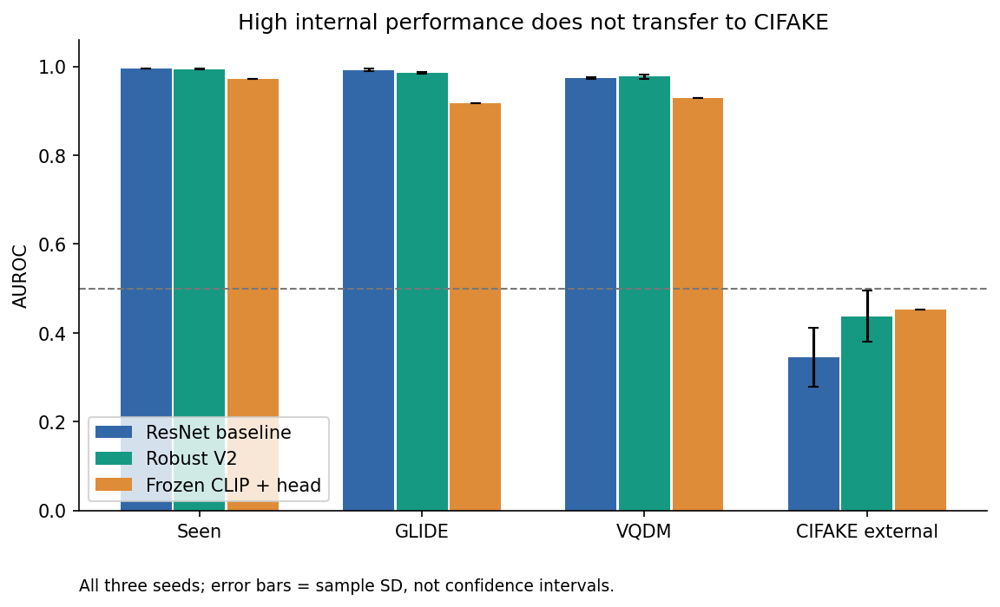
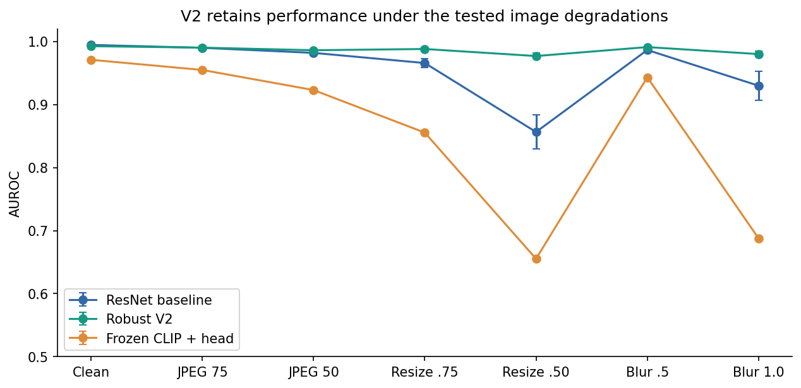
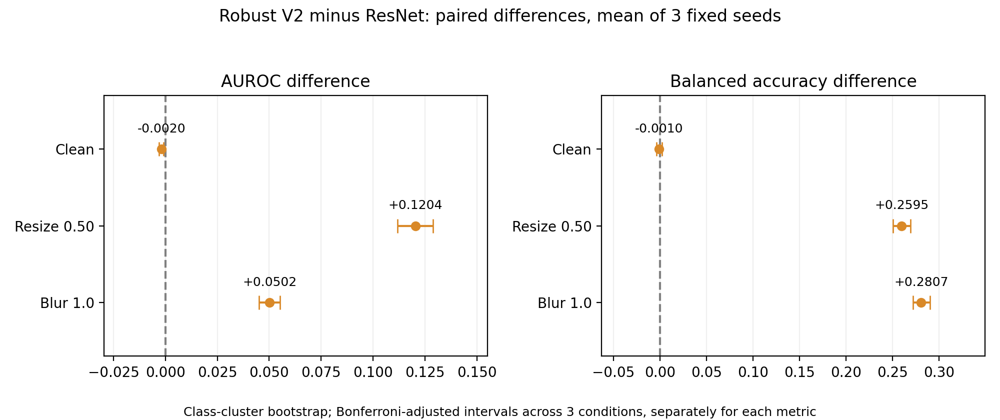
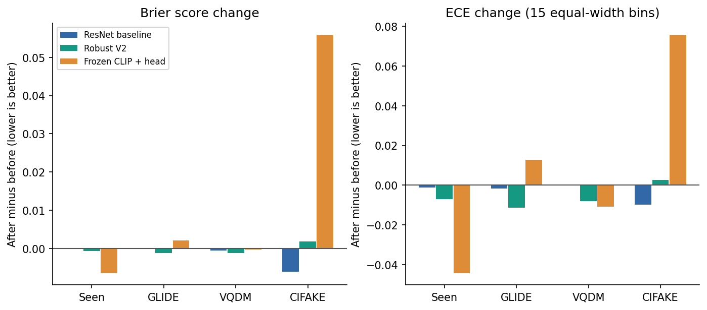
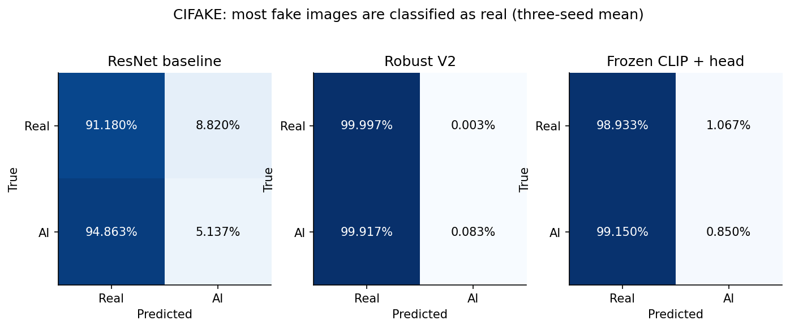
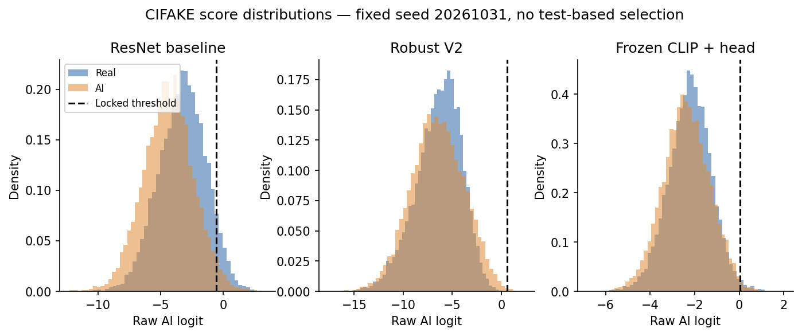
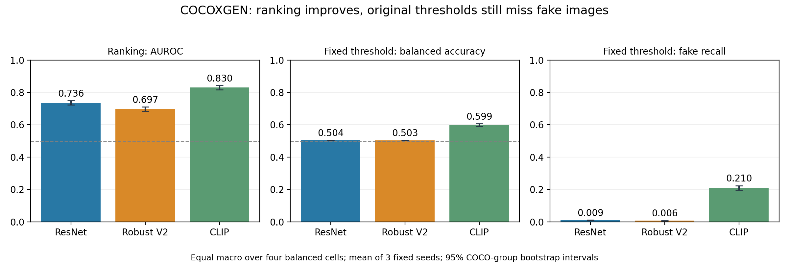
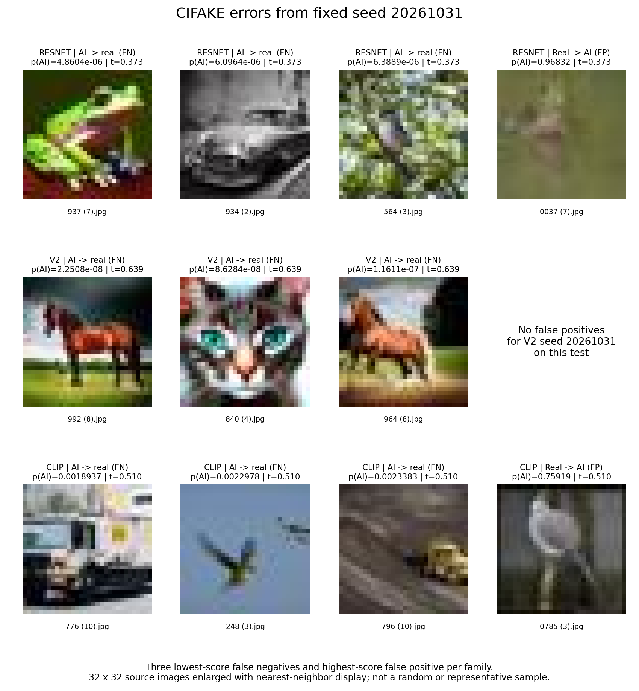

## 2026-11-19 当前实验状态

三类模型各三个种子的主实验、七条件 holdout、校准、CIFAKE/COCOXGEN 外部评估与置信区间已完成。新增诊断结果与原始数据统一放在 `handoff/2026-11-16/`。

| 工作 | 完成范围 | 主要发现 |
|---|---|---|
| 分数分布 | ResNet/V2/CLIP 各三种子 | CIFAKE 排序失效，COCOXGEN 假图得分偏低 |
| 分辨率控制 | 一个 ResNet 与三个 V2，三测试集×三条件，共36组 | 降低分辨率导致明显退化，V2 low64 存在较大种子波动 |
| 阈值迁移 | 按COCO原图组划分318组开发、743组保留 | 适配能减少漏检，同时真图误报明显上升 |
| 生成配置 | 四配置、三个模型家族各三种子 | 长提示词配置平均AUROC较低，属于描述性比较 |

已见集 V2 的 original/low64/low32 AUROC 分别为 0.9936/0.7852/0.4277。COCOXGEN 保留集适配后 ResNet/V2/CLIP 平衡准确率分别为66.11%/63.71%/74.76%，真图误报率分别为34.50%/31.99%/21.09%。分辨率处理先保持比例限制最长边，再执行 cap128_jpeg95，低分辨率会改变后续JPEG处理产生的图像，当前结论限定为整个指定处理流程的影响。

本轮属于外部结果已查看后的诊断。新的开发/保留划分只用于事后适配分析。尚未隔离分辨率、生成内容、来源与处理历史各自的因果贡献，配置差异尚无新增显著性检验。演示沿用此前未验收状态，新增九模型权重长期备份仍待团队完成。

> 文档状态更新于 2026-11-19。分数诊断、36 组分辨率评估、COCOXGEN 阈值适配与生成配置分析已完成，见[最新实验补充报告](../2026-11-16/README.md)。九模型主实验结果见 [三种子主报告](FINAL_REPORT.md)。历史章节中的待办以当前交接说明为准。

# AI 生成图像检测实验结果与项目交付报告

核验日期：2026 年 11 月 8 日。范围：已提供的仓库源代码、四批服务器结果及 CIFAKE、COCOXGEN 外部测试数据。本文是可整合进课程报告的实验章节与交付审计，不代表已经核对老师的评分要求，也不替代组员原报告中的背景与文献综述。

## 摘要

本项目比较受控输入下的 ResNet 基线、鲁棒增强 V2，以及冻结 CLIP 图像编码器加线性分类头。每类模型使用三个随机种子，并在固定 GenImage 划分、独立图片 holdout 扰动测试和 CIFAKE、COCOXGEN 两个外部来源上评估。ResNet 在 GenImage seen 和 GLIDE 上的平均 AUROC 最高；V2 在所测缩放、模糊扰动下更稳定。然而，三个模型家族在 CIFAKE 上的平均 AUROC 均低于 0.5，且大部分假图被预测为真图。在新增 COCOXGEN 上，CLIP 的宏平均 AUROC 达到 0.82968，但固定原阈值的假图召回率仅 20.96%，显示排序能力与可用的分类决策之间仍有差距。验证集温度校准并非普遍有效，在 CIFAKE 上还会恶化 V2 和 CLIP 的部分概率指标。

结论是：受控输入与鲁棒增强能改善特定条件下的检测，但现有实验不支持将模型作为可靠的通用 AI 图像鉴别器。外部失败结果是本项目的实质性发现，应保留在报告中。

## 1 实验问题与方法

研究问题包括：同来源和未见生成器的检测能力、图片退化下的鲁棒性、概率校准能否迁移，以及换数据来源后是否仍然有效。正类统一为 AI 假图（1），真图为 0。模型输出称为 AI 分数；未经验证的分数不应宣传为可靠的真实性概率。

三类模型均保留原仓库预处理：最长边不超过 128 像素、JPEG 质量 95 的统一输入控制，随后使用各模型原有的输入变换。ResNet/V2 使用原实现的缩放、中心裁剪和归一化；CLIP 使用固定图像处理器。V2 的训练增强对两类图片对称：约一半样本不额外退化，另一半随机选一种缩放、JPEG 或模糊，不叠加三种退化。

新增 ResNet 两种子使用最多 10 epochs、batch 64、AdamW 学习率 1e-4、weight decay 1e-4、验证 AUROC 无提升 patience 3。新增 CLIP 分类头复用已审核的冻结特征，最多 500 epochs、AdamW 学习率 1e-2、weight decay 1e-4、patience 20。CLIP 分类头训练是原函数的全批量特征训练；提取特征时的 batch 128 不是分类头训练 mini-batch。V2 三个已有 checkpoint 直接复用，没有重新训练。

种子固定为 20261031、20261101、20261102。所有种子均报告；不依据测试成绩选取最好种子。分类阈值来自各模型原验证报告。新增实验未使用测试集重新选择阈值、checkpoint 或温度。

## 2 数据与评价协议

| 数据 | 图片数 | 用途 |
|---|---|---|
| GenImage train | 40,000 | 原训练划分 |
| GenImage val | 8,000 | checkpoint 与阈值选择；温度拟合 |
| GenImage seen | 10,000 | 同来源测试 |
| GLIDE | 4,000 | 未见生成器测试 |
| VQDM | 4,000 | 未见生成器测试 |
| 图片 holdout | 6,000 | clean 及六种预定退化 |
| CIFAKE 官方 test | 20,000 | 跨数据集测试，真图假图各 10,000 |
| COCOXGEN | 5,305 | 1,061 真图及每个原图编号对应的四张合成图 |

固定清单不重新抽样。七种 holdout 条件是 clean、JPEG 75、JPEG 50、resize 0.75、resize 0.50、Gaussian blur 0.5 和 1.0。退化图片是同一批 6,000 张图片的派生版本，不能当作 42,000 个独立样本。holdout 仍来自 GenImage/ImageNet；不能把它当成独立外部来源。

CIFAKE 使用作者仓库版本 `e112a942abaecd02b6b1f6f646c807d56be8fb62` 的全部官方测试图片。20,000 张均为 32×32，解码通过。检查发现 38 个同标签重复文件（19,962 个唯一文件哈希），与既有 72,000 个 GenImage 路径无完全相同的文件哈希。该检查不证明不存在近重复、重编码图片或基础模型预训练数据交集。真实图片来自 CIFAR-10，假图来自 SD 1.4；SD 1.4 已在 GenImage 训练来源中，因此 CIFAKE 是跨数据来源测试，不是未见生成器测试。

主要报告 AUROC、AP、固定阈值 Accuracy/F1，以及 Brier、NLL 和 ECE。ECE 使用 15 个等宽 p(AI) 分箱，比较平均预测概率与实际正类比例。表中“±”为三个种子的样本标准差（ddof=1），不是置信区间或显著性检验。CIFAKE 排序指标使用原始 logits，避免 sigmoid 饱和导致数值并列。

## 3 常规测试与外部泛化

| 模型 | Seen AUROC | GLIDE AUROC | VQDM AUROC | CIFAKE AUROC |
|---|---|---|---|---|
| resnet | 0.99533 ± 0.00078 | 0.99210 ± 0.00270 | 0.97419 ± 0.00242 | 0.34534 ± 0.06679 |
| v2 | 0.99360 ± 0.00088 | 0.98501 ± 0.00204 | 0.97690 ± 0.00475 | 0.43781 ± 0.05771 |
| clip | 0.97196 ± 0.00002 | 0.91804 ± 0.00008 | 0.92852 ± 0.00009 | 0.45244 ± 0.00036 |

图 1 显示内部高性能与外部泛化失败同时存在。V2 的 VQDM 均值略高，但三个种子的波动不足以支持未经检验的“显著优于”结论。CIFAKE AUROC 低于 0.5 表示当前分数排序在该数据集上失效，而不只是阈值不合适。没有反转分数或标签来提高外部成绩。

## 4 鲁棒性结果

在 resize 0.50 条件下，ResNet、V2、CLIP 的平均 AUROC 分别为 0.85638、0.97682、0.65528；在 blur 1.0 下分别为 0.92977、0.97993、0.68770。V2 在这些预定退化下保留更多区分能力，但 clean 条件下 ResNet 的平均 AUROC 略高。不能把这些合成退化测试等同于现实平台所有压缩流程或任意未知数据分布。

完整七条件结果及种子标准差见 `tables/holdout_results.csv`。CLIP 的强退化下降也说明，使用大型预训练编码器不自动保证下游检测头的鲁棒性。

### 4.1 配对置信区间

对 clean、resize 0.50、blur 1.0 三个指定条件补充 2,000 次配对 cluster bootstrap，按 1,000 个语义类别成组，保留每类真假图、生成器及不同扰动之间的对应关系。对三个固定种子先算各模型指标再取均值；不会把三个种子当成独立的三倍图片样本。以下是 V2−ResNet 的 AUROC 差值：

| 条件 | 差值 | 95% 配对区间 |
|---|---|---|
| clean | −0.00200 | [−0.00297, −0.00111] |
| resize 0.50 | +0.12045 | [+0.11323, +0.12743] |
| blur 1.0 | +0.05016 | [+0.04602, +0.05436] |

图 8 使用按每个指标跨三个条件作 Bonferroni 校正的区间，AUROC 差值方向仍成立。这支持“小幅干净图片排序代价，换取显著的指定退化排序提升”的有限结论。缩放条件下假图召回差值区间包含0；模糊条件下V2假图召回略低，因此不能写成所有指标全面改善。平衡准确率的大幅提升主要反映真图识别改善。细节见 `tables/followup_paired_differences.csv`。这些是既有测试被查看之后补充的分析，不应描述为研究开始前注册的确认性检验。

## 5 温度校准

温度 T 仅在原 GenImage 验证集上最小化二元 NLL，应用方式为 sigmoid(logit/T)，不在任何测试集重新拟合。阈值同步进行同一个单调变换，以保留原分类决策。这种校准针对概率尺度，而不是通过换阈值提高 Accuracy 或 F1。

CLIP 在 seen 上的平均 Brier 从 0.06622 改善到 0.05976，ECE 从 0.06862 改善到 0.02428；但 GLIDE 的 Brier 从 0.12028 恶化到 0.12241，ECE 从 0.07824 恶化到 0.09099。不能根据测试集结果为不同测试来源分别挑选是否开启校准。应同时透明报告校准前后结果。

原验证集也曾用于 checkpoint 和阈值选择，因此校准后的验证集表现是样本内结果，不构成独立泛化证据。新增实验未创建独立校准集或进行嵌套验证。

## 6 CIFAKE 失败分析

| 模型 | Accuracy | F1 | 假图召回率 | Brier 原始 → 校准 | ECE 原始 → 校准 |
|---|---|---|---|---|---|
| resnet | 48.16% | 0.09013 | 5.14% | 0.43974 → 0.43361 | 0.39878 → 0.38900 |
| v2 | 50.04% | 0.00166 | 0.08% | 0.49168 → 0.49354 | 0.49182 → 0.49435 |
| clip | 49.89% | 0.01668 | 0.85% | 0.40696 → 0.46284 | 0.37746 → 0.45317 |

固定阈值下 V2 的假图平均召回率约 0.08%，CLIP 约 0.85%。在正负各半的数据上，几乎全部预测为真图也能得到约 50% Accuracy，因此这里的 Accuracy 不能被解读为模型有效。与始终预测 0.5 概率的参考 Brier=0.25 相比，三类模型的原始 Brier 都更差。

32×32 输入、来源语义、生成流程及图像处理痕迹均可能造成分布变化；本实验没有独立控制这些因素，所以不能把失败因果归结为单一分辨率因素。没有在 CIFAKE 上重新训练或调参。去除完全重复文件后的敏感性分析显示，九个模型的 AUROC 最大绝对变化为 0.000659，结论不变；主结果仍使用官方完整 20,000 张测试集。

## 6.2 COCOXGEN：较高分辨率外部验证

固定数据版本为 `c336ad187c2ab298ce825df65088bdacbae104f6`。使用全部 1,061 张 COCO val2017 真图与 4,244 张合成图，不按结果筛选；每个原图编号对应 Fooocus/SDXL 各自长/短提示词四个版本。实际解码尺寸为 3,183 张 640×480、2,122 张 1152×864。服务器对既有 92,000 张图片检查文件字节与解码 RGB 哈希，无重叠，新增集合也无完全重复。此结论不排除近重复或 CLIP/生成器预训练接触；本地核验依据服务器审计记录，未重新下载所有原图。

评估继续使用原有 cap128_jpeg95 输入控制、checkpoint、阈值与验证集温度。每个“生成器×提示长度”与全体真图组成 2,122 张平衡测试单元；主要指标先对四个单元等权平均，再对三个固定种子平均。全量集合的假图比例为 80%，其普通 Accuracy 只作次要指标，不能直接与 CIFAKE 平衡集比较。

| 模型 | 宏平均 AUROC [95% CI] | 平衡准确率 [95% CI] | 假图召回率 [95% CI] |
|---|---|---|---|
| resnet | 0.73601 [0.72330, 0.74942] | 0.50440 [0.50334, 0.50558] | 0.00943 [0.00746, 0.01155] |
| v2 | 0.69718 [0.68446, 0.70999] | 0.50314 [0.50236, 0.50404] | 0.00628 [0.00471, 0.00809] |
| clip | 0.82968 [0.81725, 0.84262] | 0.59885 [0.59158, 0.60639] | 0.20963 [0.19651, 0.22330] |

图 7 的区间为 2,000 次 COCO 原图编号成组 bootstrap：同一编号的真图与四个合成变体共同抽样，全部模型和种子使用相同抽样。CI 与三个种子的样本标准差不是同一个量；后者另存于 `tables/followup_external_summary.csv`。

CLIP 在此来源的平均排序能力最高，但固定阈值仍漏检约 79% 假图。ResNet/V2 的 AUROC 高于 0.5，假图召回率却均低于 1%，显示原验证阈值在新分布上不适用。这与 CIFAKE 的平均 AUROC 低于 0.5 是不同的失败形式。不能据此在测试集选择新阈值，也不能把两个数据集表现之差全部归因于分辨率；内容与生成流程也同时改变。校准前后完整指标保留在 `tables/followup_external_metrics.csv`，分类决策保持不变。

`cases/cocoxgen_error_cases.csv` 保存九模型各前20个可用假图漏检/真图误报的路径、原图组、分数与阈值。此次下载的结果包不包含COCOXGEN原图，因此只提供经预测核验的案例索引，不把它冒充可视化案例拼图。

## 7 错误案例

图 6 固定展示 seed 20261031：每类模型分数最低的三个假图漏检，以及分数最高的一个真图误报。V2 在该种子没有真图误报，因此对应位置明确留作说明，不用其他种子补齐。展示规则是失败极端案例，不是随机样本，也不代表错误分布；不据此声称模型关注了某个视觉区域。原始 32×32 图片仅作最近邻放大，不增加细节。图片从作者固定版本取回，并与服务器记录的 SHA256 逐一核对。

`cases/cifake_error_cases.csv` 包含各模型前 20 个可用 FN/FP 的路径、分数、阈值和哈希；`cases/genimage_error_cases.csv` 包含内部三个测试集各模型前 10 个可用 FN/FP。后者已完成数值与路径索引，但本地没有共享 GenImage 原图，因此未伪造内部案例拼图。可用附带 CPU 导出脚本从共享数据取回少量指定案例，不必再申请 GPU。

## 8 复现与核验

运行环境记录为 Python 3.11.18、PyTorch 2.11.0+cu128、torchvision 0.26.0+cu128、NVIDIA L20。各作业保存了实际安装依赖，避免把组员完整环境清单视作完全相同的环境。计算平台为学校 Slurm；任务通过 sbatch 执行，SSH 断线不影响已提交批处理。

| 作业 | 内容 | 运行时长 |
|---|---|---|
| 2218770 | 三种子内部测试与 ResNet/V2 holdout | 18 分 08 秒 |
| 2227379 / 2227380 / 2227381 | 编码器准备 / 第二批 GPU / 校准汇总 | 27 秒 / 6 分 07 秒 / 10 秒 |
| 2227671 / 2227672 / 2227673 | CIFAKE 准备 / 九模型 GPU / 汇总 | 5 分 21 秒 / 2 分 03 秒 / 7 秒 |
| 2228010 / 2228011 / 2228012 / 2228013 | 旧结果 CI / 外部准备 / 一次 GPU / 汇总 | 15 秒 / 38 分 12 秒 / 4 分 37 秒 / 12 秒 |

以上均为已记录运行时间，不含排队，也不包含先前训练全部模型的费用。四批流程均以退出码 0:0 完成。

核验覆盖第一批 69 份逐图预测、第二批 57 份预测文件及 114 行指标、CIFAKE 九个预测文件及 18 行指标。标签方向核对为 REAL=0、FAKE=1。CIFAKE AUROC 使用独立秩和计算复核，概率指标和混淆计数复算通过，温度变换前后决策一致。CLIP 32 个验证样本的缓存兼容性抽查最低余弦相似度为 0.9999989；这是抽查兼容性证据，不是历史编码器来源的完整证明。

补充一致性检查覆盖九模型×四个旧测试域，每模型256张图片，共2304次预测对照。ResNet/V2抽样概率差为0；CLIP最大绝对概率差为2.3201×10⁻⁷；36项对照均无分类决策翻转。GenImage三个域的原相对路径清单与合并绝对路径清单预处理张量完全一致。这是固定抽样的端到端数值一致性证据，不代表所有图片逐位复现。本地已复算新增90行指标，并使用独立秩和公式复核AUROC，重新生成四个外部bootstrap流与主结果置信区间；原holdout类别分组清单仍在服务器，其区间保留服务器计算结果。

## 9 局限与可支持的结论

1. 未见生成器测试仍共享 GenImage/ImageNet 来源；此前测试结果已有查看记录，后续补充实验不能声称是全新未查看的测试。
2. 三个种子只反映有限的训练随机性。新增配对 cluster bootstrap 区间描述固定模型条件下的测试抽样不确定性，不包括重新训练新种子的不确定性。
3. CIFAKE 与 COCOXGEN 是两个特定外部来源，仍不足以代表现实社交媒体、最新生成模型或所有真实照片；后者不是分辨率单因素控制实验。
4. 校准使用原验证集且存在分布迁移失败；演示界面应明确标注“AI 分数”和校准适用限制。
5. 文件哈希与新增的解码 RGB 哈希检查不覆盖全部近重复、编辑或预训练数据污染；不能声明完全消除了数据泄漏。
6. 错误图是按预先说明的分数规则选取，不是因果解释或注意力可视化。

综上，项目已经形成“内部表现较高—特定扰动提升有配对区间支持—外部排序随来源变化且原阈值迁移失效”的完整实验证据链。下一步优先完成论文与PPT；用户已取消本轮演示验收。不要为了提高已观察到的 CIFAKE 成绩反复调参。若未来研究跨域训练，应另设开发数据与新的未查看测试集。

## 10 贡献与项目剩余工作

组员已有工作包括固定数据清单、基础模型与 V2 权重、原始测试和项目代码；本次接手补充了 ResNet/CLIP 的种子实验、统一三种子测试、六个 ResNet/V2 holdout 评估、CLIP 扰动比较、温度校准、九模型 CIFAKE/COCOXGEN 外部测试、端到端抽样一致性检查、配对置信区间及结果审计。此处按可核查产物归类，不推断具体个人曾完成但未交接的其他工作。

核心实验与本报告图表已完成。仍需完成或确认：论文作者将本实验章节与原方法/背景内容整合为最终课程论文；本轮demo验收已取消，原演示代码保留但未验证；新增权重长期备份；按老师实际要求补齐作者、课程格式、篇幅和展示材料。当前仓库演示源代码已取得，但没有运行验收；课程最终提交规范仍未提供。GPU 实验不需要因为这些交付事项而重跑。

## 参考资料与数据来源

- 项目仓库：https://github.com/jshui1015/AI-Image-Detection 。本轮分析基于交接代码与实际作业输出；交接时已读取仓库基础版本并核对四个核心文件哈希。
- GenImage 官方项目：https://github.com/GenImage-Dataset/GenImage 。本实验使用固定交接清单及共享图片。
- Bird, J. J., and Lotfi, A. CIFAKE: Image Classification and Explainable Identification of AI-Generated Synthetic Images. IEEE Access, 2024. https://arxiv.org/abs/2303.14126 。数据：https://github.com/jordan-bird/CIFAKE-Real-and-AI-Generated-Synthetic-Images 。作者说明真实图来自 CIFAR-10，使用时也应引用 Krizhevsky and Hinton (2009), Learning Multiple Layers of Features from Tiny Images。
- Moeßner, P., and Adel, H. (2025). Human vs. AI: A Novel Benchmark and a Comparative Study on the Detection of Generated Images and the Impact of Prompts. https://aclanthology.org/2025.genaidetect-1.2/ 。COCOXGEN 数据：https://huggingface.co/datasets/heikeadel/cocoxgen 。真图来自 COCO val2017；另引用 Lin et al. (2014), Microsoft COCO: Common Objects in Context.
- 实际证据：`evidence/` 内四批报告与预测；`tables/` 内可追溯汇总；`audit.json` 内核验摘要。所有图均来自这些数值，没有使用示意或合成结果。
